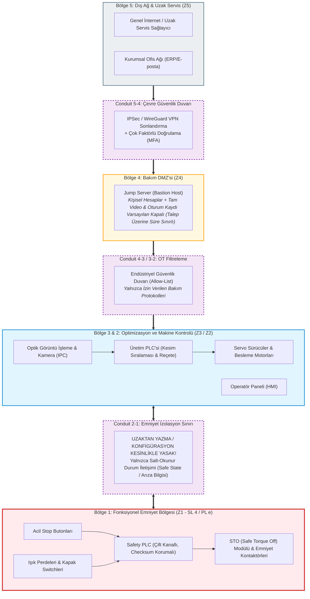

# 🛡️ Safety 4.0: UKM-OPT Otomatik Boy Kesme Makinesi — Emniyet ve Siber Güvenlik Mimarisi

[](https://opensource.org/licenses/MIT)
[](https://www.isa.org/standards-and-publications/isa-standards/isa-standards-committees/isa99)
[-red.svg)](https://www.iso.org/standard/69883.html)
[-purple.svg)](https://digital-strategy.ec.europa.eu/en/policies/cyber-resilience-act)
[](https://eur-lex.europa.eu/eli/reg/2023/1230/oj)

Bu depo, **Safety 4.0 Bootcamp** kapsamında geliştirilen **UKM-OPT (Otomatik Optik Boy Kesme Makinesi)** endüstriyel sisteminin **Fonksiyonel Emniyet (Functional Safety)** ve **Endüstriyel Siber Güvenlik (OT Cyber Security)** mimarisinin 7 laboratuvar çıktısını (Lab 1 - Lab 7), mimari diyagramlarını, stratejik SWOT analizini ve Evidence Pack (Kanıt Paketi) dokümantasyonunu içermektedir.

---

## 📌 Yönetici Özeti ve Mevzuat Bağlamı

Sanayi 4.0 ile birlikte üretim makineleri internete, uzaktan servis modüllerine ve yapay zeka destekli görüntü işleme sistemlerine bağlanmaktadır. Ancak bu dijitalleşme yeni bir tehlikeyi beraberinde getirdi: **Bir siber müdahale emniyet fonksiyonunu bozup insana fiziksel zarar verebiliyorsa, bu artık bir IT açığı değil; doğrudan bir EMNİYET BULGUSUDUR.**

İki kritik mevzuat bu dönüşümü zorunlu kılmaktadır:
1. **11 Eylül 2026 — AB Siber Dayanıklılık Yasası (CRA - Cyber Resilience Act):** Dijital unsurlu ürünlerde bildirim yükümlülüğü başlamıştır (24 saat erken uyarı / 72 saat detaylı bildirim zinciri; 15 M€ veya cironun %2,5'i oranında ceza tavanı).
2. **20 Ocak 2027 — AB Makine Tüzüğü (EU 2023/1230):** Geçiş süresi olmaksızın yürürlüğe girmiştir. Siber güvenlik artık makine CE uygunluğunun ve piyasaya arzın **ön şartıdır**; mekanik koruma tek başına yeterli değildir.

---

## 🏭 Makine Profili: UKM-OPT (Otomatik Boy Kesme Makinesi)

UKM-OPT; endüstriyel ahşap, profil veya metal parçaların boylarını kamera ve görüntü işleme algoritmalarıyla milimetrik olarak optimize eden ve yüksek hızlı pnömatik/servo testere bıçağı ile otomatik kesen bir üretim tezgahıdır.

* **Üretici Firma:** Üstünkarlı Makine A.Ş. (Endüstriyel Ağaç İşleme Makineleri)
* **Normal Üretim Yolu:** Optik Kamera $\rightarrow$ IPC (Görüntü İşleme) $\rightarrow$ Üretim PLC $\rightarrow$ Servo Sürücüler $\rightarrow$ Kesim Testeresi ve Besleme Aktüatörü.
* **Fonksiyonel Emniyet Yolu:** Koruyucu Işık Perdesi + Kapak Kilit Switchleri + E-Stop $\rightarrow$ Çift Kanallı Safety PLC $\rightarrow$ STO (Safe Torque Off) $\rightarrow$ Güvenli Durum (Safe State).
* **Temel Risk:** Kesim koordinatlarının manipülasyonu veya optik ölçüm-enkoder uyuşmazlığı nedeniyle malzemenin sıkışması; operatörün müdahalesi anında beklenmeyen kesici hareketinin oluşması (amputasyon ve ezilme riski).

---

## 📚 Laboratuvar Dokümantasyonu (Tüm Lablar & Stratejik Analizler)

| No | Laboratuvar / Analiz Başlığı | Temel Odak ve Mühendislik Kavramı | Çıktı Belgesi | Evidence Pack Eşleşmesi |
| :---: | :--- | :--- | :--- | :---: |
| **01** | [**Lab 1: Safety Architecture**](docs/lab-01-safety-architecture.md) | Normal Kontrol Yolu vs Bağımsız Emniyet Yolu ayrımı, "Sarı Çizgi" risk noktası, PLr/SIL ve Safe State gereksinimleri. | `Safety Function Map` | **EP 03 (Safety Functions)** |
| **02** | [**Lab 2: IEC 62443 Mini Workshop**](docs/lab-02-iec-62443-zones-conduits.md) | Varlıkların 5 temel güvenlik bölgesine (Z1-Z5) ayrılması, kontrollü geçiş kapıları (Conduits) ve 6 satırlık güvenli uzak erişim karar tablosu. | `Zone / Conduit Diagram` | **EP 05 (Zone & Conduit)** |
| **03** | [**Lab 3: Threat & Risk Matrix**](docs/lab-03-threat-and-risk-matrix.md) | 5 parçalı siber-fiziksel senaryo modeli ($Kim \rightarrow Kapı \rightarrow Eylem \rightarrow Zincir \rightarrow Fiziksel Zarar$), $L \times S \times E$ matrisi ve hayati $S=3$ kuralı. | `Risk Register` | **EP 04 (Risk Assessment)** |
| **04** | [**Lab 4: Secure Remote Access**](docs/lab-04-secure-remote-access.md) | Çift katmanlı savunma modeli (Erişim Güvenliği + Emniyet Bağımsızlığı), Mevcut vs Hedef mimari, uzaktan emniyet müdahalesi yasağı. | `Secure Architecture` | **EP 02 + EP 06 (Remote Access)** |
| **05** | [**Lab 5: SBOM / CVE / Patch**](docs/lab-05-sbom-cve-patch.md) | SBOM envanteri, zafiyet değerlendirmesinde "Üç Şart Kuralı", CVSS vs Safety, testbed doğrulama ve telafi edici önlemler. | `Vulnerability Decision` | **EP 09 · 10 · 11 (Vulnerability & Patch)** |
| **06** | [**Lab 6: CRA Incident Simulation**](docs/lab-06-cra-incident-simulation.md) | Yetkisiz erişim simülasyonu, "Önce Emniyet Sonra Kanıt", 15dk/2s/24s/72s/14g müdahale takvimi ve adli bilişim (forensics). | `Incident Workflow` | **EP 13 (Incident Response)** |
| **07** | [**Lab 7: AI Safety Challenge**](docs/lab-07-ai-safety-challenge.md) | "Prediction $\neq$ Safety", girdi bütünlüğü, güven skoru eşiği, YZ dışı sabit limitler ve deterministik fallback mekanizması. | `AI Fail-Safe Decision` | **EP 03 + EP 15 (AI Risk Management)** |
| **—** | [**UKM-OPT SWOT Analizi**](docs/swot-analizi.md) | Üstünkarlı Makine A.Ş. UKM-OPT makinesinin güçlü/zayıf yönleri, siber güvenlik fırsatları ve tehdit stratejileri. | `SWOT Matrix & Actions` | **Siber Güvenlik Eylem Planı** |

---

## 🏛️ Bütünleşik Güvenlik Mimarisi (IEC 62443 + Safety Independence)

Aşağıdaki mimari şema, UKM-OPT makinesinde uygulanan kademeli savunma derinliği (Defense-in-Depth) ve fonksiyonel emniyet izolasyonunu göstermektedir:



---

## 🎯 Projenin Temel İlkeleri (The Golden Rules)

1. **Altın Kural:** Zincir *"veri çalındı"* veya *"ekran dondu"* ile bitiyorsa emniyet bulgusu değildir; bu olayın hattaki operatöre **fiziksel olarak ne yaptığı** gösterilmelidir.
2. **$S=3$ Kuralı:** Ağır uzuv kaybı veya ölüm riski ($S=3$) taşıyan senaryolar, siber olasılık skoru düşük kalsa dahi asla arka plana atılamaz; doğrudan öncelikli inceleme ve aksiyon planına alınır.
3. **Emniyet Bağımsızlığı İlkesi:** Uzaktan bakım erişimi veya üretim kontrol sistemi (PLC/IPC) tamamen ele geçirilse dahi, fonksiyonel emniyet donanımı (Safety PLC $\rightarrow$ STO) operatörü bağımsız korumaya devam etmelidir.
4. **Yerinde Değişiklik İlkesi:** Emniyet mantığı veya muting/blanking parametreleri uzaktan yazılamaz; yalnızca yerinde, yetkili uzman ve fiziksel anahtarla değiştirilebilir.
5. **Üç Şart Kuralı (SBOM & CVE):** CVSS 9.8 tek başına fabrikayı durdurma sebebi değildir; bileşen var mı, sürüm etkileniyor mu ve açık ağdan ulaşılabilir mi kontrol edilir.
6. **Önce Emniyet, Sonra Kanıt:** Olay anında asla *"resetle devam et"* yapılmaz. Önce insanı korumak için Safe State'e geçilir, hemen sonra adli kanıtlar (loglar, imajlar) dondurulur.
7. **Prediction $\neq$ Safety:** Yapay zeka istatistiksel bir tahmin motorudur; emniyeti garanti eden kurallar, sabit sınırlar (hard limits) ve emniyet zinciri YZ'nin tamamen dışında tanımlanır.

---

## 📂 Dizin Yapısı

```
safetyArchitecture/
├── .gitignore                                 # Git takip dışı dosyalar
├── README.md                                  # Ana proje ve mimari rehberi
├── docs/
│   ├── lab-01-safety-architecture.md          # Lab 1: Safety Function Map (EP 03)
│   ├── lab-02-iec-62443-zones-conduits.md      # Lab 2: Zone & Conduit Diagramı ve Karar Tablosu (EP 05)
│   ├── lab-03-threat-and-risk-matrix.md       # Lab 3: Siber-Fiziksel Risk Analizi ve Risk Register (EP 04)
│   ├── lab-04-secure-remote-access.md         # Lab 4: Güvenli Uzak Erişim ve Emniyet Bağımsızlığı (EP 02/06)
│   ├── lab-05-sbom-cve-patch.md               # Lab 5: SBOM, Zafiyet ve Yama Karar Akışı (EP 09/10/11)
│   ├── lab-06-cra-incident-simulation.md      # Lab 6: Olay Müdahale ve CRA Bildirim Zaman Çizelgesi (EP 13)
│   ├── lab-07-ai-safety-challenge.md          # Lab 7: YZ Hata Güvenliği ve Emniyet Mimarisi (EP 03/15)
│   └── swot-analizi.md                        # UKM-OPT Makinesi Siber Güvenlik SWOT Analizi
├── diagrams/
│   ├── safety-function-map.mmd                # Lab 1 Mermaid kaynak diyagramı
│   ├── zones-and-conduits.mmd                 # Lab 2 Mermaid kaynak diyagramı
│   ├── attack-tree-risk.mmd                   # Lab 3 Mermaid kaynak diyagramı
│   ├── secure-remote-access.mmd               # Lab 4 Mermaid kaynak diyagramı
│   ├── vulnerability-decision-flow.mmd        # Lab 5 Mermaid kaynak diyagramı
│   ├── cra-incident-timeline.mmd              # Lab 6 Mermaid kaynak diyagramı
│   └── ai-safety-failsafe-architecture.mmd    # Lab 7 Mermaid kaynak diyagramı
└── resources/
    ├── Sunum.pdf                              # Safety 4.0 Bootcamp eğitim sunumu
    └── swotAnalizi.docx                       # SWOT analizinin orijinal Microsoft Word dökümanı
```

---

## 👨‍💻 Yazar & Teşekkür
* **Faruk Aydın** — Yazılım Mühendisliği & Safety 4.0 Araştırmacısı
* **Eğitim Programı:** Safety 4.0 Bootcamp — Endüstriyel Emniyet ve Siber Güvenlik Mimarisi
