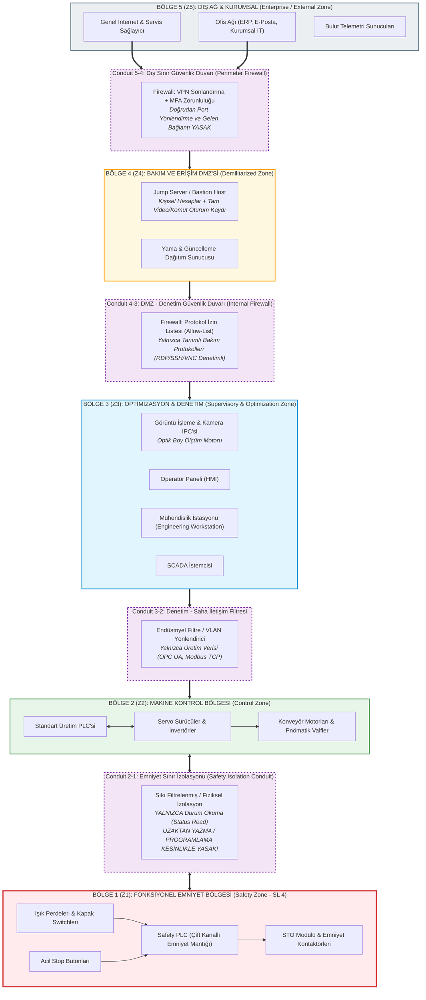

# Laboratuvar 2: IEC 62443 Mini Workshop (Bölgeleme ve Geçiş Kanalları)
**Makine Adı:** UKM-OPT · Otomatik Boy Kesme Makinesi  
**Bootcamp Sürümü:** Safety 4.0 Bootcamp — UKM-OPT  
**Çıktı Belgesi:** Zone / Conduit Diagram  
**Evidence Pack Karşılığı:** `Evidence Pack EP 05 — Zone & Conduit`  
**İlgili Standartlar:** IEC 62443-3-2 (Risk Değerlendirmesi ve Bölgeleme), IEC 62443-3-3 (Sistem Güvenliği Gereksinimleri), IEC 62443-4-2 (Bileşen Güvenliği)

---

## 👨‍🏫 Mentor Notu: Zone & Conduit Mantığı
Geleneksel endüstriyel ağlarda en sık yapılan ölümcül hata **"Düz Ağ" (Flat Network)** tasarımıdır. Düz bir ağda ofis bilgisayarına gelen bir oltalama e-postası veya internete açık tek bir port, saldırganın doğrudan üretim PLC'sine veya Safety PLC'ye ulaşmasına izin verir.

IEC 62443 standardının özü şudur:
* **Zone (Bölge):** Benzer güvenlik kritikliği ve işletim hedefine sahip donanım ve yazılımların mantıksal/fiziksel olarak bir araya getirilmesi.
* **Conduit (Geçiş Kanalı):** İki farklı bölge arasındaki iletişimin aktığı tekil, filtrelenmiş, denetlenen ve kayıt altına alınan kapıdır.
* **Kural:** Her bölge sınırında bir conduit vardır. İki bölge birbirine doğrudan, kuralsız ve kontrolsüz bağlanamaz!

---

## 🏗️ Zone / Conduit Mimari Şeması

Aşağıdaki diyagramda UKM-OPT makinesinin IEC 62443 prensiplerine göre yapılandırılmış 5 ana bölgesi ve aralarındaki kontrollü geçiş kapıları (conduit) gösterilmiştir:

---

## 📝 Görev A — Varlıkların Bölgelere Ayrılması ve Analizi

### Varlık Listesi:
`PLC` · `HMI` · `Robot Kontrolörü / Sürücüler` · `Safety PLC` · `SCADA İstemcisi` · `Mühendislik İstasyonu` · `Uzak Servis Erişimi` · `Ofis Ağı (ERP/E-posta)` · `Optik Kamera ve IPC`

### 1. Hangi varlıklar aynı bölgede? Bölgeleri adlandırıp gruplandırın.
* **Bölge 1 (Z1 - Emniyet Bölgesi):** Safety PLC, optik ışık perdeleri, acil stop butonları, koruyucu kapak interlockları ve STO kontaktörleri.
* **Bölge 2 (Z2 - Makine Kontrol Bölgesi):** Standart üretim PLC'si, servo sürücüler, invertörler ve besleme aktüatörleri.
* **Bölge 3 (Z3 - Optimizasyon ve Denetim Bölgesi):** Kamera ve optik görüntü işleme ünitesi (IPC), HMI operatör dokunmatik paneli, SCADA istemcisi ve mühendislik iş istasyonu.
* **Bölge 4 (Z4 - Bakım & Erişim DMZ'si):** Jump Server (Bastion Host), oturum kayıt sunucusu ve yerel güncelleme havuzu.
* **Bölge 5 (Z5 - Dış Ağ & Kurumsal Bölge):** Kurumsal ofis ağı (ERP, MES, kurumsal e-posta), internet omurgası, bulut telemetrisi ve harici uzak servis erişim kanalları.

### 2. Safety PLC'yi hangi bölgeye koydunuz — neden?
* **Cevap:** **Z1 Emniyet Bölgesine (Safety Zone)** yerleştirildi. Çünkü Safety PLC insan canını doğrudan koruyan en kritik varlıktır. Tesisin üretim kontrol ağında veya gözetim ağında bir siber ihlal meydana gelse dahi, bu ihlalin emniyet sistemine sıçramasını engellemek için Safety PLC bağımsız ve en yüksek güvenlik seviyesine (Security Level 4) sahip izole bir bölgede konumlandırılmalıdır. Uzak bakım modülü ise kesinlikle emniyet bölgesinde veya üretim kontrol ağında değil; aradaki **Z4 Bakım DMZ'sinde** bulunmalı, doğrudan internete veya emniyet ağına temas etmemelidir.

### 3. Bölgeler arası geçişler (conduit) nerede? Her geçişte ne kontrol edilecek?
* **Cevap:**
  1. **Z5 (Dış Ağ) $\leftrightarrow$ Z4 (DMZ):** IPSec/SSL VPN sonlandırma, kurumsal kimlik denetimi ve çok faktörlü doğrulama (MFA) kontrol edilir. Doğrudan port yönlendirme engellenir.
  2. **Z4 (DMZ) $\leftrightarrow$ Z3 (Denetim):** Yalnızca tanımlı jump server üzerinden yetkilendirilmiş protokollerle (RDP/SSH/VNC) geçişe izin verilir; izin listesi (allow-list) dışındaki tüm trafik filtrelenir ve oturum tam kayıt altına alınır.
  3. **Z3 (Denetim) $\leftrightarrow$ Z2 (Kontrol):** Yalnızca operasyonel endüstriyel protokoller (OPC UA, Modbus TCP, PROFINET) denetlenir; rastgele internet veya ofis protokolleri geçemez.
  4. **Z2 (Kontrol) $\leftrightarrow$ Z1 (Emniyet):** Yalnızca emniyet durum okuma (Safe State, hata kodları vb. salt-okunur veriler) sinyallerine izin verilir. Safety PLC'ye uzaktan program yükleme, firmware güncelleme veya mantık parametresi yazma yolu conduit üzerinde **tamamen kilitlidir**. Bu işlemler yalnızca sahada, fiziksel mühendislik anahtarı ile yapılır.

---

## 🔒 Görev B — Uzak Erişim Karar Tablosu (6 Satır)

Aşağıdaki kararlar, UKM-OPT makinesinde yetkisiz müdahaleleri önlemek ve siber dayanıklılık mevzuatlarını (CRA & NIS2) karşılamak için seçilmiştir:

| Karar Başlığı | Mevcut Seçenekler | Seçimimiz | Teknik ve Emniyet Gerekçesi |
| :--- | :--- | :--- | :--- |
| **1. Aracı?** | Doğrudan / Jump server | **Jump server** | Makine ve kontrolörler internete asla doğrudan açılmaz. Tek ve merkezi olarak izlenen, güvenlik duvarı arkasında bir ara nokta (bastion host) kullanılır. |
| **2. Tünel?** | Açık / VPN | **VPN** | Dışarıdan gelen tüm veri trafiği güçlü şifreli tünellerden (IPSec/WireGuard/TLS) geçer. Açık port taraması yapan otomatik internet botları makineyi keşfedemez. |
| **3. Kimlik?** | Parola / MFA | **MFA (Çok Faktörlü Doğrulama)** | Tek başına statik parola yeterli değildir; çalınan, sızan veya tahmin edilen şifrelerin yetkisiz girişe yol açması engellenir. |
| **4. Hesap?** | Paylaşılan / Kişisel | **Kişisel Hesap** | Ortak kullanılan genel hesaplar (`admin/admin`, `service`) yasaklanır. Her teknisyenin kendi tekil hesabı olur; kimin, ne zaman, hangi parametreyi değiştirdiği izlenebilir. |
| **5. Kayıt?** | Yok / Tam oturum kaydı | **Tam oturum kaydı** | Uzak bağlantı esnasında yapılan tüm terminal komutları, fare tıklamaları ve ekran oturumu adli bilişim (forensics) ve kaza sonrası kök neden analizi için arşivlenir. |
| **6. Zamanlama?** | Sürekli açık / Varsayılan kapalı | **Varsayılan kapalı** | 7/24 internete açık kapı sürekli bir saldırı yüzeyidir. Erişim yalnızca arıza/bakım anında talep edilir; yetkili onayıyla belirli bir süre (ör. 2 saat) için açılır ve süre bitince otomatik kapanır. |

---

## 📌 Evidence Pack Çıktı Özeti
* **Belge No:** EP 05
* **Durum:** Doldurulmuş & Doğrulamaya Hazır
* **Kritik Çıkarım:** Güvenli uzaktan erişim mimarisi, kontrol sistemlerini doğrudan internete açmak yerine DMZ ve Jump Server üzerinden kademelendirilerek kurgulanmalıdır. Emniyet bölgesi (Z1), diğer tüm ağlardan en sıkı izolasyon kurallarıyla ayrılmalıdır.
