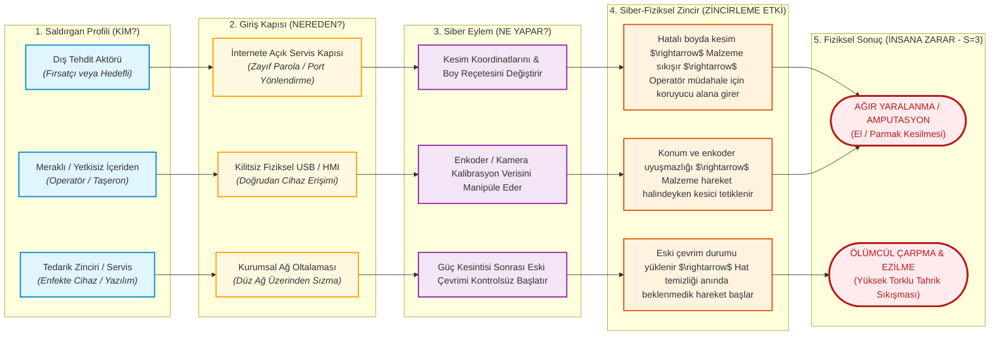

# Laboratuvar 3: Threat & Risk + Risk Matrix (Tehdit Modelleme ve Risk Matrisi)
**Makine Adı:** UKM-OPT · Otomatik Boy Kesme Makinesi  
**Bootcamp Sürümü:** Safety 4.0 Bootcamp — UKM-OPT  
**Çıktı Belgesi:** Risk Register (Risk Kayıt Kütüğü)  
**Evidence Pack Karşılığı:** `Evidence Pack EP 04 — Risk Assessment`  
**İlgili Standartlar:** ISO 12100 (Risk Değerlendirmesi), ISO 13849-1 (Emniyet Performansı), IEC 62443-3-2 (OT Siber Risk Analizi)

---

## 👨‍🏫 Mentor Notu: Siber-Fiziksel Risk Yaklaşımı
Geleneksel bilgi teknolojileri (IT) güvenliğinde CIA üçlüsü (Gizlilik, Bütünlük, Erişilebilirlik) esastır ve bir ihlal çoğunlukla *"veri sızdırıldı"* veya *"sunucu çöktü"* ile biter. 

Endüstriyel Emniyette (OT Safety) ise **Altın Kural** geçerlidir:
> **"Zincir 'veri çalındı' veya 'ekran karardı' ile bitiyorsa, bu henüz bir emniyet bulgusu değildir. Bir adım daha ileri gitmelisiniz: Bu siber olay sahadaki, hattaki insana FİZİKSEL olarak ne yapar?"**

### 5 Parçalı Senaryo Modeli:
Bir OT siber-fiziksel risk senaryosu mutlaka şu 5 bileşenden oluşmalıdır:
1. **Kim (Saldırgan Profili):** Dış fırsatçı, hedefli saldırgan, içerideki meraklı/yetkisiz personel veya enfekte tedarik zinciri.
2. **Hangi Kapı (Giriş Noktası):** İnternete açık uzak servis, zayıf parolalı HMI, ofis ağından oltalama, servis bilgisayarı/USB.
3. **Ne Yapar (Siber Eylem):** Kesim koordinatını değiştirir, emniyet muting süresini uzatır, enkoder kalibrasyonunu bozar.
4. **Zincir (Siber-Fiziksel Etki):** Yanlış boyutta malzeme kesilir $\rightarrow$ konveyörde sıkışma yaşanır $\rightarrow$ operatör müdahale etmek için tehlikeli alana yaklaşır.
5. **Fiziksel Sonuç (İnsana Zarar):** Bıçak iner $\rightarrow$ el/parmak amputasyonu veya ezilme gerçekleşir.

---

## 🌳 Siber-Fiziksel Saldırı Ağacı (Attack Tree)

---

## 📊 Risk Matrisi ve Puanlama Kriterleri

$$\text{Risk Skoru} = L \times S \times E$$

* **Olasılık (Likelihood - L):** 1: Düşük, 2: Orta, 3: Yüksek
* **Şiddet (Severity - S):** 1: Hafif ilk yardım, 2: Geçici yaralanma/iş görmezlik, 3: Ağır/Kalıcı uzuv kaybı veya ölüm
* **Maruz Kalma (Exposure - E):** 1: Nadir/Yılda birkaç, 2: Vardiyada düzenli, 3: Sürekli/Tehlike anında kaçış imkansız

### Öncelik Aralıkları:
* **Kritik:** 18 – 27
* **Yüksek:** 9 – 17
* **Orta:** 4 – 8
* **Düşük:** 1 – 3

> ⚠️ **Hayati Kural ($S=3$ Kuralı):**  
> Eğer bir senaryoda Şiddet $S=3$ (insana kalıcı fiziksel zarar, ölüm veya uzuv kaybı) ise; toplam skor matematiksel olarak düşük kalsa dahi (örneğin $1 \times 3 \times 1 = 3$), senaryo **asla göz ardı edilemez!** Listede otomatik olarak en öncelikli riskler arasına çekilir ve zorunlu teknik inceleme altına alınır.

---

## 📋 Görev: UKM-OPT Makinesi Risk Register (Risk Kayıt Kütüğü)

| No | Senaryo (Kim $\rightarrow$ Kapı $\rightarrow$ Eylem $\rightarrow$ Zincir $\rightarrow$ Fiziksel Sonuç) | L | S | E | Skor ($L \times S \times E$) | Öncelik Seviyesi |
| :---: | :--- | :---: | :---: | :---: | :---: | :---: |
| **1** | **Kesim Planı Manipülasyonu:** Dış tehdit / yetkisiz ağ erişimi $\rightarrow$ Kesim optimizasyon reçetesini değiştirir $\rightarrow$ Yanlış koordinat nedeniyle malzeme sıkışır $\rightarrow$ Operatör sıkışan parçayı düzeltmek için koruyucu alana yaklaşır $\rightarrow$ Beklenmeyen kesim hareketiyle uzuv kaybı. | 2 | **3** | 2 | **12** | **Yüksek** |
| **2** | **Enkoder ve Kamera Uyuşmazlığı:** İçeriden yetkisiz kullanıcı / IPC müdahalesi $\rightarrow$ Enkoder verisi ile optik kamera ölçümünün senkronizasyonunu bozar $\rightarrow$ Sistem malzemeyi yanlış konumda algılar ve kesiciye hatalı tetikleme verir $\rightarrow$ Operatör besleme yaparken bıçağın inmesi ve el amputasyonu. | 2 | **3** | 2 | **12** | **Yüksek** |
| **3** | **Elektrik Kesintisi Sonrası Eski Çevrim Geri Yüklemesi:** Tedarik zinciri / firmware hatası / ani elektrik kesintisi $\rightarrow$ Yeniden başlama sırasında eski iş emri ve eski çevrim durumu kontrolsüz geri yüklenir $\rightarrow$ Hat temizliği veya bakım yapan personelin varlığında makine aniden start alır $\rightarrow$ Yüksek torklu besleme ve kesim darbesi. | 1 | **3** | 1 | **3** | **Düşük Skor $\rightarrow$ $S=3$ Kuralı ile ZORUNLU İNCELEME & ÖNCELİK** |

---

## 📝 Föy Soruları ve Analizler (Doldurulmuş Çıktı)

### Soru 1: En yüksek öncelikli senaryonuz hangisi? Bir cümleyle: neden bu?
* **Cevap:** **İlk iki senaryo (Senaryo 1 ve Senaryo 2):** Çünkü doğrulanmamış veya manipüle edilmiş konum bilgisinin gecikmeksizin doğrudan fiziksel bir kesim hareketine dönüşmesi ve operatörün bu alana rutin olarak yaklaşması riski vardır.

### Soru 2: $S=3$ olup skoru düşük kalan senaryonuz var mı? Nasıl görünür kılacaksınız?
* **Cevap:** **Evet, elektrik kesintisi sonrası yeniden başlatma senaryosu (Senaryo 3):** Skoru $1 \times 3 \times 1 = 3$ çıkmasına rağmen, şiddet değeri $S=3$ (ağır kalıcı yaralanma/ölüm) olduğu için risk tablosunun en altına gömülmesine izin verilmez. Risk kütüğünde matematiksel skora göre değil, önce $S$ derecesine göre filtrelenir; üzerine **"KIRMIZI ETİKET: $S=3$ İnsan Zararı"** ibaresi basılır ve yönetimin 90 günlük öncelikli güvenlik eylem planına ayrı bir test maddesi olarak eklenir.

---

## 📌 Evidence Pack Çıktı Özeti
* **Belge No:** EP 04
* **Durum:** Doldurulmuş & Önceliklendirilmiş
* **Kritik Çıkarım:** Güvenlik açıklarının değerlendirilmesinde sadece siber olasılık ($L$) değil; fiziksel emniyet etkisi ($S$) birincil belirleyici olmalıdır. İnsan uzvunu tehlikeye atan her açık, olasılığı düşük olsa bile öncelikli kapatılmalıdır.
