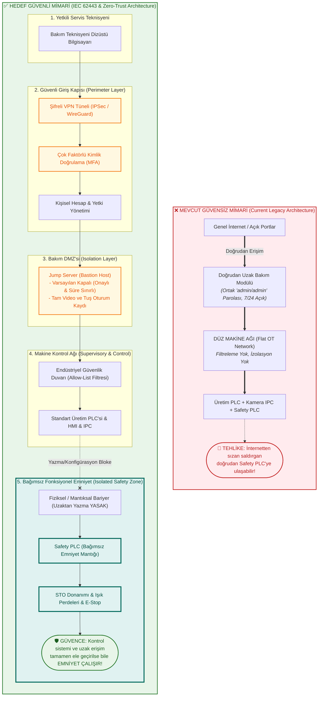

# Laboratuvar 4: Secure Remote Access (Güvenli Uzak Erişim ve Emniyet Bağımsızlığı)
**Makine Adı:** UKM-OPT · Otomatik Boy Kesme Makinesi  
**Bootcamp Sürümü:** Safety 4.0 Bootcamp — UKM-OPT  
**Çıktı Belgesi:** Secure Architecture (Güvenli Mimari Belgesi)  
**Evidence Pack Karşılığı:** `Evidence Pack EP 02 — Network Topology` & `EP 06 — Secure Remote Access`  
**İlgili Standartlar & Mevzuat:** IEC 62443-3-3, IEC 62443-2-4 (Hizmet Sağlayıcı Güvenliği), ISO 13849-1, AB Siber Dayanıklılık Yasası (CRA 2026)

---

## 👨‍🏫 Mentor Notu: Çift Katmanlı Savunma Modeli
Endüstri 4.0 ve uzaktan bakım dünyasında en tehlikeli yanılgı şudur: *"VPN kurduk, artık tamamen güvendeyiz."*  
VPN yalnızca veri tünelini şifreler; ancak VPN anahtarını ele geçiren veya servis dizüstü bilgisayarı enfekte olmuş bir saldırgan ağın içine sızdığında onu durduracak ikinci bir hat yoksa facia kaçınılmazdır.

Bu nedenle mimarimizi **İki Katmanlı** inşa ediyoruz:
1. **Katman 1 — Erişim Güvenliği (Girişi Zorlaştır):** Jump Server (Bastion), VPN, MFA, Kişisel Hesap, Tam Oturum Kaydı ve Varsayılan Kapalı (Default Deny / On-Demand) prensipleri.
2. **Katman 2 — Emniyet Bağımsızlığı (Functional Safety Independence):** Bir saldırgan 1. katmandaki tüm siber kontrolleri aşsa ve üretim PLC'sini tamamen ele geçirse dahi; **Emniyet Fonksiyonu (Safety PLC $\rightarrow$ STO $\rightarrow$ Safe State) fiziksel ve mantıksal olarak bağımsız çalışmalı, insanı korumaya devam etmelidir.**

---

## 🏗️ Mevcut ve Hedef Mimari Karşılaştırması

---

## 📝 Görev A — Mevcut Durumdan Hedef Mimariye Geçiş

### 1. MEVCUT MİMARİ (Güvensiz Durum)
* **Akış:** `İnternet` $\rightarrow$ `Uzak Bakım Modülü (Doğrudan açık port / Port Yönlendirme)` $\rightarrow$ `Düz Makine Kontrol Ağı`.
* **Zafiyetler:**
  * Tek ve ortak paylaşılan hesap (`admin/admin` veya jenerik servis şifresi),
  * Çok faktörlü kimlik doğrulama (MFA) yok,
  * Oturum kaydı veya denetim izi (audit log) tutulmuyor,
  * Modül internete 7 gün 24 saat kesintisiz açık,
  * Ağ düz (flat) olduğu için uzak bakım modülünden doğrudan Safety PLC'ye ve kamera IPC'sine ulaşılabiliyor.

### 2. HEDEF MİMARİ (5 İlke ile Yeniden Tasarım)
* **Akış:** `İnternet` $\rightarrow$ `IPSec / SSL VPN` $\rightarrow$ `MFA Doğrulaması` $\rightarrow$ `DMZ İçindeki Jump Server` $\rightarrow$ `Endüstriyel Güvenlik Duvarı (İzin Listesi)` $\rightarrow$ `Yalnızca Yetkili Üretim PLC / IPC / HMI Arayüzü`.
* **Beş İlke:**
  1. **Aracı (Jump Server):** Dış kullanıcı makineye doğrudan bağlanamaz; DMZ'deki denetimli ve izole sıçrama sunucusuna bağlanır.
  2. **VPN:** Açık internet portu bırakılmaz, tüm iletişim şifreli tünelden akar.
  3. **MFA:** Statik parola tek başına anlamsızdır, zaman tabanlı tek kullanımlık kod (TOTP/FIDO2) zorunludur.
  4. **Kişisel Hesap:** Ortak hesaplar tamamen iptal edilir, her bakım teknisyeni adına açılmış tekil hesaplar tanımlanır.
  5. **Kayıtlı ve Süreli Erişim:** Varsayılan olarak kapalıdır; bakım talebi onaylanınca süre sınırlı (ör. 2 saat) açılır ve tüm oturum video/komut bazında kaydedilir.

---

## 🌉 Görev B — Functional Safety Köprüsü (Emniyet Bağımsızlığı)

### Soru 1: Saldırgan tüm önlemlere rağmen içeri girerse: emniyet fonksiyonu etkilenir mi? Neden?
* **Cevap:** **Evet, eğer emniyet yapılandırmasına veya tehlikeli hareket komutlarına erişebiliyorsa etkilenebilir.**  
Eğer üretim PLC'si veya IPC ile Safety PLC arasında kontrolsüz bir yazma yolu bırakılmışsa ("sarı çizgi") ya da uzaktan emniyet parametreleri (muting, tepki süresi, interlock bypass) güncellenebiliyorsa, saldırgan fiziksel korumayı devre dışı bırakabilir. Bu nedenle kontrol sistemi ile emniyet sistemi arasındaki bağımsızlığın mimari düzeyde doğrulanması ve düzenli penetrasyon/bypass testlerine tabi tutulması şarttır.

### Soru 2: Emniyet fonksiyonunun kontrol sisteminden bağımsız çalışması için GEREKSİNİMİ yazın (çözümü değil).
> **Temel Emniyet Gereksinimi (Safety Requirement):**  
> *"Uzaktan bakım erişimi, optik kamera veya üretim PLC'si üzerinden emniyet fonksiyonlarının devre dışı bırakılmasına ya da doğrulanmamış tehlikeli bir hareketin tetiklenmesine yol açmamalıdır. Emniyet sistemi, kontrol katmanı ve uzak erişim mekanizması tamamen ele geçirilse dahi insanı koruyacak Safe State garantisini bağımsız olarak sağlamalıdır."*

---

## 📐 Üç Altın Mimari Emniyet Şartı (Architectural Invariants)

1. **Bağımsız Çalışma Güvencesi:**  
   Emniyet fonksiyonu, standart üretim kontrol sistemi ve uzak erişim yolu tamamen ele geçirilse, çökse veya manipüle edilse dahi gereken performans seviyesinde (PLr / SIL) tavizsiz çalışmaya devam etmelidir.
2. **Yerinde Fiziksel Değişiklik İlkesi:**  
   Emniyet konfigürasyonu ve Safety PLC yazılımı yalnızca yerinde (fiziksel olarak makine başında), kimliği doğrulanmış yetkili uzman tarafından ve fiziksel güvenlik anahtarı açılarak değiştirilebilmeli; **uzaktan hiçbir koşulda değiştirilememelidir.**
3. **Kriptografik Bütünlük ve Değişiklik Tespiti:**  
   Emniyet yapılandırmasındaki her değişiklik donanımsal imza/checksum ile anlık tespit edilebilmeli ve doğrulanmamış herhangi bir değişiklik durumunda makine derhal Safe State'e geçerek çalışmayı reddetmelidir.

---

## 📌 Evidence Pack Çıktı Özeti
* **Belge No:** EP 02 & EP 06
* **Durum:** Doldurulmuş & Onay Aşamasına Hazır
* **Kritik Çıkarım:** Teknoloji ne kadar gelişirse gelişsin, uzaktan bakım asla Safety PLC'nin emniyet mantığına yazma yetkisi alamaz. Siber güvenlik saldırganı kapıda durdurmayı hedefler; fonksiyonel emniyet ise saldırgan içeri girse bile operatörün elini korumayı garanti eder.
