# Laboratuvar 5: SBOM / CVE / Patch (Zafiyet Yönetimi ve Yama Karar Akışı)
**Makine Adı:** UKM-OPT · Otomatik Boy Kesme Makinesi  
**Bootcamp Sürümü:** Safety 4.0 Bootcamp — UKM-OPT  
**Çıktı Belgesi:** Vulnerability Decision (Zafiyet Değerlendirme Kararı)  
**Evidence Pack Karşılığı:** `Evidence Pack EP 09 (SBOM)`, `EP 10 (Vulnerability Management)`, `EP 11 (Patch Management)`  
**İlgili Standartlar & Mevzuat:** IEC 62443-4-1, IEC 62443-4-2, AB Siber Dayanıklılık Yasası (CRA 2026 Madde 11), ISO 13849-1

---

## 👨‍🏫 Mentor Notu: IT ile OT Arasındaki Kritik Yama Farkı
Klasik kurumsal bilişimde (IT) bir güvenlik açığı çıktığında yaklaşım basittir: *"Hemen yamayı indir, işletim sistemini güncelle ve sistemi yeniden başlat (reboot)."*

Endüstriyel Otomasyon ve Fonksiyonel Emniyette (OT/Safety) ise **bu yaklaşım felakete yol açabilir:**
1. **Üretim Kesintisi Maliyeti:** Makine durduğunda dakikada binlerce liralık hammadde ve iş gücü israfı oluşabilir.
2. **Sessiz Emniyet Bozulması (Silent Safety Invalidation):** Üretim PLC'sine veya sürücüye uygulanan plansız bir yama, haberleşme döngü süresini (cycle time) milisaniyeler mertebesinde değiştirebilir. Bu durum emniyet ağında (ör. PROFIsafe) zaman aşımına veya optik ışık perdesinin tepki mesafesinin geçersiz kalmasına neden olabilir!
3. **Altın Kural: "CVSS 9.8 (Critical) tek başına fabrikayı durdurma sebebi değildir!"**  
Bir açığın sistemi gerçekten etkileyebilmesi için **ÜÇ ŞARTIN BİRLİKTE** sağlanması gerekir:
   - **Bileşen Var mı?** (SBOM listesinde mevcut mu?)
   - **Sürüm Etkileniyor mu?** (Bizdeki versiyon açık aralığında mı?)
   - **Açık Ulaşılabilir mi?** (Saldırgan ilgili port/protokole fiziksel veya ağ üzerinden erişebiliyor mu?)

---

## 🔄 Zafiyet Karar Akışı Şeması (Vulnerability Decision Flow)

```mermaid
flowchart TD
    START(["Yeni Zafiyet Bildirimi Alındı<br/><i>(Örn: Component X, v2.4, CVSS 9.8 Critical)</i>"]) --> COND1{"1. ŞART: BİLEŞEN VAR MI?<br/><i>(SBOM Envanterinde Kayıtlı mı?)</i>"}
    
    COND1 -- "HAYIR" --> NOT_AFFECTED(["ETKİLENMİYORUZ<br/><i>(Kayıt altına al ve kapat)</i>"])
    COND1 -- "EVET" --> COND2{"2. ŞART: SÜRÜM ETKİLENİYOR MU?<br/><i>(UKM-OPT'deki sürüm zafiyet aralığında mı?)</i>"}
    
    COND2 -- "HAYIR" --> NOT_AFFECTED
    COND2 -- "EVET" --> COND3{"3. ŞART: AÇIK ULAŞILABİLİR Mİ?<br/><i>(Ağdan veya port üzerinden erişilebilir mi?)</i>"}
    
    COND3 -- "HAYIR" --> MONITOR(["DÜŞÜK ACİLİYET / İZLEME<br/><i>(Conduit izolasyonu korundu, izlemeye al)</i>"])
    COND3 -- "EVET" --> AFFECTED["🚨 ÜÇ ŞART SAĞLANDI: SİSTEM ETKİLENİYOR!<br/><i>(Acil Müdahale Prosedürü Başlat)</i>"]
    
    AFFECTED --> EVAL_SAFE{"Fiziksel Emniyet Fonksiyonu<br/>veya Operatör Riski Var mı?"}
    
    EVAL_SAFE -- "EVET (Doğrudan Risk)" --> SAFE_STOP["GÜVENLİ DURUŞ (Safe State)<br/><i>(Makineyi kontrollü durdur)</i>"]
    EVAL_SAFE -- "HAYIR / İkincil Risk" --> COMPENSATE["TELAFİ EDİCİ ÖNLEMLER (Compensating Controls)<br/>- Uzaktan erişimi kapat<br/>- İlgili portu conduit'te engelle<br/>- PLC erişimini allow-list ile filtrele"]
    
    SAFE_STOP --> COMPENSATE
    COMPENSATE --> PATCH_AVAIL{"Doğrulanmış Üretici Yaması<br/>Mevcut mu?"}
    
    PATCH_AVAIL -- "HAYIR / Gecikmeli" --> ISOLATE_PLAN["İzolasyonu Sürdür &<br/>Üreticiyle İletişime Geç"]
    PATCH_AVAIL -- "EVET" --> TEST_ENV["TEST ORTAMI / YEDEK PLC DOĞRULAMASI<br/><i>(Canlı üretimde doğrudan ASLA uygulanmaz!)</i>"]
    
    TEST_ENV --> SAFETY_CHECK{"Safety Validation Etkileniyor mu?<br/><i>(Safety Checksum Değişti mi?)</i>"}
    
    SAFETY_CHECK -- "EVET" --> REVALIDATE["FONKSİYONEL EMNİYET YENİDEN TESTİ<br/><i>(Işık perdesi, E-stop, STO test çubuğuyla doğrulanır)</i>"]
    SAFETY_CHECK -- "HAYIR" --> MAINTENANCE_WINDOW["PLANLI BAKIM PENCERESİNDE UYGULAMA<br/><i>(Tam yedek + Geri dönüş planı ile)</i>"]
    
    REVALIDATE --> MAINTENANCE_WINDOW
    MAINTENANCE_WINDOW --> SIGN_OFF(["YENİ SBOM VE EP 09-11 GÜNCELLEMESİ<br/><i>(Doğrulanmış Kayıt Olarak Arşivle)</i>"])

    classDef startNode fill:#e1f5fe,stroke:#0288d1,stroke-width:2px;
    classDef decision fill:#fff8e1,stroke:#ffa000,stroke-width:2px;
    classDef danger fill:#ffebee,stroke:#d32f2f,stroke-width:2px,color:#b71c1c;
    classDef action fill:#f3e5f5,stroke:#7b1fa2,stroke-width:2px;
    classDef success fill:#e8f5e9,stroke:#388e3c,stroke-width:2px,color:#1b5e20;

    class START startNode;
    class COND1,COND2,COND3,EVAL_SAFE,PATCH_AVAIL,SAFETY_CHECK decision;
    class AFFECTED,SAFE_STOP danger;
    class COMPENSATE,TEST_ENV,REVALIDATE,MAINTENANCE_WINDOW,ISOLATE_PLAN action;
    class NOT_AFFECTED,MONITOR,SIGN_OFF success;
```

---

## 📋 Verilen Zafiyet Kaydı ve Ön Değerlendirme

| Parametre | Zafiyet Bildirimi Değeri | UKM-OPT Değerlendirmesi |
| :--- | :--- | :--- |
| **Bileşen** | `Component X` (PLC Firmware Kütüphanesi) | Üretim PLC'si ve/veya Safety PLC firmware katmanında kullanılan ağ/protokol kütüphanesi. |
| **Sürüm** | `2.4` | Sahadaki makinede kurulu olan aktif versiyon ile karşılaştırılacak. |
| **CVE Kodu** | `CVE-XXXX-XXXX` | Resmi güvenlik açığı bülteni ve NVD (National Vulnerability Database) kaydı. |
| **Önem / CVSS** | **Critical (CVSS 9.8)** | Uzaktan kimlik doğrulaması olmadan rastgele kod çalıştırma (RCE) potansiyeli. |
| **Yama Durumu** | **Mevcut (Patch Available)** | Donanım üreticisi tarafından yama paketi yayınlanmış. |

---

## 📝 Föy Soruları ve Analizler (Doldurulmuş Çıktı)

### Soru 1: Bu CVE sizi gerçekten etkiliyor mu? (Üç şartı kontrol edin)
* **Cevap:** **Henüz kesin olarak bilinmiyor.** CVE kimliği yer tutucu (`CVE-XXXX-XXXX`) olduğu için şu üç şart sahada doğrulanmalıdır:
  1. **Bileşen Var mı?:** UKM-OPT'nin dijital malzeme listesine (SBOM) bakılır: `Component X`, Üstünkarlı'nın kullandığı üretim PLC'sinde mi, kamera IPC'sinde mi yoksa Safety PLC'de mi yüklü?
  2. **Sürüm Etkileniyor mu?:** Makinedeki kurulu sürüm tam olarak 2.4 mü ve yayınlanan zafiyet bültenindeki etkilenen sürüm aralığında mı?
  3. **Açık Ulaşılabilir mi?:** Lab 2'de kurulan IEC 62443 Zone/Conduit mimarisine göre PLC doğrudan internete açık değildir. Ancak Z4 DMZ'sindeki Jump Server üzerinden veya Z3 Mühendislik İstasyonundan bu servise/porta erişim var mı?  
  *Yalnızca bu üç şartın tamamı doğrulanırsa "etkileniyoruz" kararı verilir.*

### Soru 2: Üretimi hemen durdurur musunuz? Neden / neden değil?
* **Cevap:** **Hayır, doğrudan ve panikle üretimi durdurmayız.**  
CVSS puanının 9.8 olması tek başına fabrikayı durdurma sebebi değildir. Öncelikle açığın aktif olarak istismar edilip edilmediği kontrol edilir ve açığın ulaşılabilirliği güvenlik duvarından (conduit) kesilerek telafi edici önlemler alınır.  
**İstisna:** Eğer zafiyet doğrudan Safety PLC'yi veya acil duruş devresini etkileyip fiziksel emniyeti riske atıyorsa veya ulaşılabilirlik üretim sürerken izole edilemiyorsa, makine derhal kontrollü biçimde **Güvenli Durum'a (Safe State)** alınır.

### Soru 3: Yamayı doğrudan mı uygularsınız, önce test mi? Nerede test?
* **Cevap:** **Asla doğrudan canlı üretimdeki makineye uygulanmaz; mutlaka önce test edilir!**  
Yama, UKM-OPT'nin donanım ve yazılım konfigürasyonunu birebir temsil eden izole bir **test tezgahında (testbed / yedek PLC ortamı)** denenir. Fonksiyonel testler, çevrim süreleri ve iletişim gecikmeleri kontrol edilir. Başarılı olursa, tam sistem yedeği ve geri dönüş (rollback) planı hazırlanarak önceden belirlenen **planlı bakım penceresinde** sahaya yüklenir.

### Soru 4: Bu yama bir safety validation (emniyet doğrulamasını) etkiliyor mu? Nasıl anlarsınız?
* **Cevap:** **PLC, servo sürücü veya emniyet parametreleri değişiyorsa evet, etkiler.**  
Nasıl anlaşılır?
  1. Donanım üreticisinin yama sürüm notları (release notes) incelenir.
  2. Yama öncesinde ve sonrasında Safety PLC'nin kriptografik **Safety Checksum / Proje İmzası** karşılaştırılır. Checksum değerinde 1 bitlik dahi fark varsa veya çevrim süresi değişmişse fonksiyonel emniyet doğrulaması bozulmuş sayılır.
  3. Bu durumda ışık perdesi tepki süresi, test çubuğu testi ve E-stop durma mesafesi EN ISO 13849-2 standardına göre yeniden fiziksel olarak test edilip onay tutanağı düzenlenmelidir.

### Soru 5: Yama hemen mümkün değilse compensating control (telafi edici önlem) ne olur?
* **Cevap:** Üretici yama yayınlamamışsa veya test süreci devam ediyorsa şu telafi edici kontroller uygulanır:
  * Etkilenen kütüphanenin dinlediği ağ portu ve servisi endüstriyel güvenlik duvarında (conduit) derhal engellenir.
  * Z4 Bakım DMZ'si ve uzaktan servis erişim modülü tamamen kapatılır (fiziksel kablo çekilir veya port bloke edilir).
  * PLC'ye erişim yalnızca tanımlı mühendislik istasyonu MAC/IP adresiyle sınırlandırılır (allow-list).
  * Ağ trafiği üzerinde anomali ve saldırı tespit (IDS/OT Monitoring) kuralları devreye alınır.
  * Alınan risk ve telafi kararı tarih, saat ve sorumlu mühendis imzasıyla Evidence Pack'e yazılır.

---

## 🛡️ Telafi Edici Önlemler (Compensating Controls) Matrisi

| Güvenlik Alanı | Mevcut Risk Durumu | Uygulanacak Telafi Edici Önlem | Doğrulama Yöntemi |
| :--- | :--- | :--- | :--- |
| **Ağ Sınırı (Conduit)** | Port internete veya geniş ağa açık | Güvenlik duvarında ilgili portu (ör. 502 Modbus, 102 S7comm, 44818 EtherNet/IP) tamamen kapat. | Nmap / port taraması ile kapalı olduğunu doğrula. |
| **Uzak Erişim** | 7/24 açık bakım modülü | Uzak erişimi "Varsayılan Kapalı"ya al; fiziksel bakım anahtarını kilitle. | Erişim günlüklerini kontrol et. |
| **Kimlik & Yetki** | Ortak kullanıcı hesapları | Servis hesaplarını devre dışı bırak; yerel mühendislik erişimini kısıtla. | Kullanıcı erişim matrisini gözden geçir. |
| **Emniyet İzolasyonu** | PLC - Safety PLC bağlantısı | Safety PLC'yi donanımsal yazma koruması (Run/Stop anahtarı) moduna al. | Emniyet checksum değerini sabitle. |

---

## 📌 Evidence Pack Çıktı Özeti
* **Belge No:** `EP 09 (SBOM)`, `EP 10 (Vulnerability Assessment)`, `EP 11 (Patch Management)`
* **Durum:** Doldurulmuş & Prosedüre Bağlanmış
* **Kritik Çıkarım:** Zafiyet yönetimi körü körüne yama yüklemek değildir. Emniyet kritik makinelerde yama, fonksiyonel güvenilirliği (Safety Validation) riske atmayacak şekilde kontrollü test laboratuvarında doğrulanmalı; yama yüklenene kadar telafi edici önlemlerle saldırı yüzeyi sıfırlanmalıdır.
