# Laboratuvar 6: CRA Incident Simulation (Siber Olay Müdahale ve Emniyet Kriz Yönetimi)
**Makine Adı:** UKM-OPT · Otomatik Boy Kesme Makinesi  
**Bootcamp Sürümü:** Safety 4.0 Bootcamp — UKM-OPT  
**Çıktı Belgesi:** Incident Workflow (Olay Müdahale İş Akışı)  
**Evidence Pack Karşılığı:** `Evidence Pack EP 13 — Incident Response`  
**İlgili Standartlar & Mevzuat:** AB Siber Dayanıklılık Yasası (CRA 2026 Madde 11), NIS2 Direktifi, ISO/IEC 27035, ISO 13849-1, IEC 62443-2-4

---

## 👨‍🏫 Mentor Notu: Sahada En Sık Yapılan Ölümcül Hata
Endüstriyel üretim tesislerinde siber veya kontrol anomalisi yaşandığında vardiya amirlerinin en sık yaptığı ölümcül hata şudur:
> **❌ "Makine saçmaladı, PLC'yi resetleyelim, elektriği aç-kapa yapıp devam edelim!"**

Bu refleks iki büyük felakete neden olur:
1. **Fiziksel Felaket:** Eğer saldırgan PLC veya sürücüdeki kesim pozisyon sınırlarını, güvenli hız limitlerini veya emniyet muting sürelerini değiştirmişse; makineyi yeniden başlatıp üretime devam etmek operatörün kesici giyotin bıçağa veya hızlı besleme tahrikine kapılarak **ağır yaralanmasına/ölümüne** sebep olabilir.
2. **Adli Bilişim (Forensics) Felaketi:** Reset düğmesine basmak veya PLC'ye temiz projeyi hemen yüklemek, RAM'de ve uçucu bellekte bulunan saldırgan IP adresini, ters bağlantı kabuklarını (reverse shell) ve değiştirilen parametre kanıtlarını **sonsuza dek yok eder!**

Bu yüzden kuralımız çok basittir:  
👉 **"ÖNCE EMNİYET (İnsanı Koru / Güvenli Duruma Al), HEMEN SONRA KANIT (Delili Koru)!"**

---

## ⏱️ CRA Olay Müdahale Zaman Çizelgesi (Incident Timeline)

Aşağıdaki şema, UKM-OPT makinesinde saat 10:15'te başlayan yetkisiz erişim vakasında 15. dakikadan nihai rapora kadar izlenen adli ve teknik müdahale sürecini göstermektedir:

```mermaid
flowchart TD
    subgraph T0["🚨 10:15 — İLK 15 DAKİKA (Acil Karantina & Güvenlik)"]
        direction TB
        E1["<b>1. Emniyeti Sağla:</b> Makineyi kontrollü güvenli duruma (Safe State) al.<br/><i>⚠️ ASLA RESETLEME! Resetlemek delilleri yok eder.</i>"]
        E2["<b>2. Ekibi Topla:</b> OT Güvenlik, Bakım Mühendisi ve İSG Sorumlusunu ara."]
        E3["<b>3. Oturumu Kes:</b> Şüpheli uzak bağlantı kablosunu çek / portu kapat."]
        E4["<b>4. Olay Günlüğü Başlat:</b> Saat damgalı adli kayıt defteri aç."]
        E1 --> E2 --> E3 --> E4
    end

    subgraph T2H["⏱️ İLK 2 SAAT (Emniyet Teyidi & Adli Kanıt Koruma)"]
        direction TB
        C1["<b>Emniyet Kontrolü:</b> Safety PLC Checksum'ını referans değerle karşılaştır.<br/>Işık perdesi ve E-Stop fonksiyon testini yap."]
        C2["<b>Kanıtı Koru:</b> PLC/Safety PLC programının adli imajını ve SHA-256 hash'ini al.<br/>Güvenlik duvarı, VPN, Jump Server ve HMI loglarını dondur."]
        C3["<b>Hesap Karantinası:</b> Yetkisiz girilen servis hesabını iptal et.<br/>Paylaşılan tüm şifreleri geçersiz kıl."]
        C1 --> C2 --> C3
    end

    subgraph T24H["📢 24 SAAT: CRA ERKEN UYARI (Early Warning Notification)"]
        direction TB
        W1["<b>Yasal Bildirim:</b> AB CRA Madde 11 uyarınca yetkili CSIRT / Ulusal Otoriteye bildirim.<br/>- Tespit saati ve makine kimliği (UKM-OPT)<br/>- Kötü niyetli siber müdahale şüphesi<br/>- Olası fiziksel riskler ve alınan ilk tedbirler"]
    end

    subgraph T72H["📑 72 SAAT: CRA DETAYLI BİLDİRİM (Detailed Incident Report)"]
        direction TB
        D1["<b>Kök Neden Analizi:</b> Saldırı vektörü, sızma kapısı ve etkilenen bileşenler.<br/><b>Emniyet Etkisi:</b> Kesici ve besleme parametrelerinde değişiklik tespiti.<br/><b>Rol Dağılımı:</b> OT/IT logları çözümler, Emniyet Mühendisi doğrulama yapar,<br/>Üst Yönetim (A) resmi raporu imzalar."]
    end

    subgraph T14D["🏁 14 GÜN / SON RAPOR (Final Forensic Closure)"]
        direction TB
        F1["<b>Kalıcı İyileştirme & Arşiv:</b> Tüm oturum logları, yama kayıtları,<br/>donanımsal güvenlik anahtarı revizyonu ve yeniden doğrulama testleri.<br/>Evidence Pack EP 13 Incident Response başlığı altına kalıcı arşivleme."]
    end

    T0 ==> T2H
    T2H ==> T24H
    T24H ==> T72H
    T72H ==> T14D

    classDef t0 fill:#ffebee,stroke:#c62828,stroke-width:2px,color:#b71c1c;
    classDef t2h fill:#fff8e1,stroke:#f57f17,stroke-width:2px,color:#e65100;
    classDef t24h fill:#e1f5fe,stroke:#0288d1,stroke-width:2px,color:#01579b;
    classDef t72h fill:#f3e5f5,stroke:#7b1fa2,stroke-width:2px,color:#4a148c;
    classDef t14d fill:#e8f5e9,stroke:#2e7d32,stroke-width:2px,color:#1b5e20;

    class T0 t0;
    class T2H t2h;
    class T24H t24h;
    class T72H t72h;
    class T14D t14d;
```

---

## 🚨 Olay Senaryosu
* **Zaman:** Saat 10:15
* **Olay Tanımı:** Servis hesabında olağan dışı yetkisiz bir ağ oturumu tespit edildi. PLC konfigürasyonunun veya kesim reçetesinin uzaktan değiştirilmiş olabileceğinden şüpheleniliyor.
* **Mevcut Durum:** Makine hâlâ çalışıyor ve hatta operatörler bulunuyor. Vardiya sorumlusu sizsiniz.

---

## 📝 Föy Soruları ve Zaman Çizgisi Analizleri (Doldurulmuş Çıktı)

### 1. 10:15 — İlk 15 Dakika: Kimi ararsınız? İlk üç eyleminiz?
* **Kimi Ararsınız?:**
  1. OT Güvenlik Ekibi / IT Sistem Yöneticisi,
  2. Bakım ve Otomasyon Şefi,
  3. İSG ve Fonksiyonel Emniyet Sorumlusu,
  4. Fabrika Yönetimi (Olay Sahibi).
* **İlk Üç Eylem:**
  1. **Makineyi Güvenli Duruma Al (Safe State):** PLC konfigürasyonu değişmiş olabileceğinden hattı derhal kontrollü şekilde durdurup Safe State'e geçir. **Asla resetleme veya programı ezme!**
  2. **Ağ İzolasyonu Yap (Oturumu Kes):** Uzaktan servis modülünün Ethernet kablosunu fiziksel olarak çek veya endüstriyel güvenlik duvarında oturumu anında sonlandır.
  3. **Saat Damgalı Olay Günlüğü (Incident Log) Başlat:** İlk tespit anından itibaren yapılan her adımı, görülen her anormalliği dakika dakika adli kayıt defterine yaz.

### 2. İlk 2 Saat: Emniyet güvende mi? Neyi korursunuz (Kanıt!)? Hangi hesap kapatılır?
* **Emniyet Güvende mi?:**  
  Safety PLC'nin proje kontrol toplamı (**Safety Checksum / Hash**) fabrikasyon referans değeriyle doğrulanır. Işık perdeleri test çubuğuyla, kapak kilit switchleri ve acil stop devreleri fiziksel olarak test edilir.
* **Neyi Korursunuz (Kanıt!):**  
  PLC ve Safety PLC içindeki mevcut yüklü program değiştirilmeden okunup hash'lenir (adli imaj alınır). Z4 DMZ'sindeki Jump Server oturum video kayıtları, güvenlik duvarı bağlantı logları, VPN giriş IP'leri, HMI denetim izleri (audit logs) ve kamera kayıtları koruma altına alınır.
* **Hangi Hesap Kapatılır?:**  
  Yetkisiz oturum açılan şüpheli servis hesabı derhal devre dışı bırakılır. Bu hesapla aynı şifreyi paylaşan veya ilişkili olan tüm genel/ortak hesapların kimlik bilgileri iptal edilir.

### 3. 24 Saat — CRA Erken Uyarı (Early Warning): Hangi bilgi hazır olmalı?
* **Cevap:** AB Siber Dayanıklılık Yasası (CRA) Madde 11 gereğince yetkili makamlara ve CSIRT birimine 24 saat içinde sunulacak erken uyarı raporunda şu bilgiler yer almalıdır:
  * Olayın tespit edildiği kesin tarih ve saat,
  * Etkilenen makine kimliği (`UKM-OPT - Otomatik Boy Kesme`), seri numarası ve yazılım/firmware versiyonu,
  * Olayın kötü niyetli veya kasti bir dış müdahale olduğuna dair bulgular,
  * Olayın potansiyel fiziksel riskleri (kesici mekanizma, operatör emniyeti) ve başka müşterilere/hatlara sıçrama ihtimali,
  * Alınan ilk karantina tedbirleri.

### 4. 72 Saat — CRA Bildirimi: Kök neden, etki, önlem — kim ne yapıyor?
* **Cevap:** 72 saat içinde kapsamlı olay bildirim raporu tamamlanır:
  * **Kök Neden:** Saldırganın içeriye hangi giriş kapısından (ör. internete doğrudan açık kalan bakım modülü veya zayıf parola) girdiği tespit edilir.
  * **Etki Değerlendirmesi:** PLC mantığında veya kesim parametrelerinde neyin değiştirildiği ve emniyet zincirinin ne derece etkilendiği raporlanır.
  * **Düzeltici Önlemler:** Alınan teknik kontroller (portların kapatılması, MFA zorunluluğu, yazılım güncellemesi) belgelenir.
  * **Rol Dağılımı (RACI):** OT ve IT ekipleri teknik log analizini yapar; Emniyet Sorumlusu fiziksel fonksiyon doğrulamasını yapar; Makine Üreticisi (Üstünkarlı) analiz desteği sunar; Üst Yönetim (**Accountable - A**) resmi yasal bildirimi onaylar.

### 5. 14 Gün / Son Rapor: Hangi loglar/kayıtlar korunmuş olmalı?
* **Cevap:** Olayın kapanış dosyasında şu kanıtlar en az yasal saklama süresi boyunca saklanmalıdır:
  * Ağ güvenlik duvarı, VPN ve Jump Server tam oturum ve paket logları,
  * Kimlik doğrulama, kullanıcı giriş/çıkış ve başarısız oturum kayıtları,
  * Değiştirilen PLC ve Safety PLC programının fark (diff) dökümleri ve kriptografik SHA-256 hash imzaları,
  * Fonksiyonel emniyet yeniden doğrulama test tutanakları ve test çubuğu ölçüm sonuçları,
  * Saat damgalı olay müdahale defteri.  
  *(Önemli Yasal Not: CRA'da 14 gün, güvenlik açığına ilişkin yama yayınlandıktan sonraki bildirim süresidir; ciddi olaylarda nihai kök neden raporlama süresi 1 aya kadar değerlendirilebilir).*

---

## 📌 Evidence Pack Çıktı Özeti
* **Belge No:** `EP 13 (Incident Response & Forensic Readiness)`
* **Durum:** Doldurulmuş & Yasal Standartlara Uyarlanmış
* **Kritik Çıkarım:** Bir siber olay sırasında en kritik iki varlık Zaman ve Kanıttır. Operatör emniyetini riske atacak aceleci bir "resetle geç" refleksi yerine, disiplinli bir karantina, emniyet doğrulama ve delil muhafaza protokolü uygulanmalıdır.
