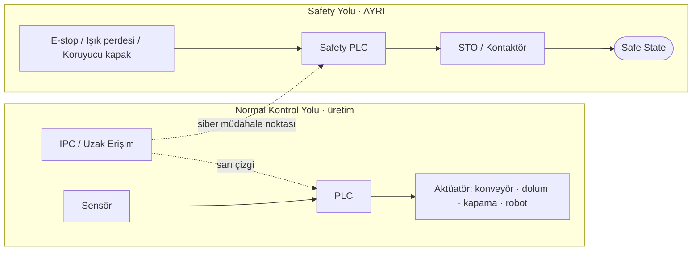

# Lab 2.1 · Lab 1: Safety Architecture — Şişeleme Hattı (Genel Sürüm)
**Çıktı:** Safety Function Map · **Evidence Pack:** EP 03 — Safety Functions

> **Varsayım:** Jenerik bir dolum-kapama hattı; konveyör, dolum ve kapama kafaları, robotlu paletleme hücresi; uzak servis erişimi tedarikçi tarafından kullanılıyor.

| # | Soru | Cevap |
|---|------|-------|
| 1 | Tehlike | Dönen kapama kafalarında ve konveyör geçişlerinde el/parmak sıkışması, robot hücresinde çarpılma, kırılan şişede cam kesiği, gazlı üründe şişe patlaması. En sık maruziyet: operatörün sıkışan şişeyi elle alması. |
| 2 | Safety function | (a) E-stop basılınca tüm tehlikeli hareketler STO ile durur. (b) Işık perdesi / koruyucu kapak ihlalinde dolum-kapama ve robot güvenli durdurulur, beklenmedik yeniden başlama engellenir. |
| 3 | Safety-related control system | Alt yolun tamamı: E-stop + ışık perdesi (giriş), Safety PLC (mantık), STO/kontaktör (çıkış) ve emniyet bağlantıları. Üst yoldaki PLC, HMI ve IPC bunun parçası değildir. |
| 4 | Normal PLC vs Safety PLC | Normal PLC üretim içindir, tek kanallıdır, hatası sessiz kalabilir. Safety PLC çift kanallı, kendini test eden, sertifikalıdır (PL/SIL); hata algılarsa güvenli duruma geçer; programı imza/checksum ile korunur. |
| 5 | PLr / SIL | Korumanın riskle orantılı güvenilirliğini belirler. Kapama kafasında ciddi/geri dönüşsüz yaralanma, sık maruziyet ve zor kaçınma nedeniyle tipik **PL d** beklenir (kesin değer ISO 13849 hesabıyla bulunur). |
| 6 | Safe state | Tehlikeli hareketlerin enerjisi kesilmiş (STO), makine durmuş, kendiliğinden yeniden başlayamaz; yalnız bilinçli reset ile çalışır. Basınçlı hatlar tahliye edilmiştir. |
| 7 | Dijital bağımlılıklar | Safety PLC programı/parametreleri (muting/blanking, tepki süresi, reset mantığı), firmware, emniyet ağı (ör. PROFIsafe), mühendislik istasyonu + parolası. |
| 8 | Siber müdahale noktası | Sarı çizgi: IPC/uzak erişim → aynı ağdaki mühendislik istasyonu → Safety PLC konfigürasyonu. Muting genişletilir veya bypass konursa fonksiyon kâğıt üzerinde var ama işlevsizdir. |

> *Bu çıktı eğitim amaçlıdır, resmî denetim değildir.*
