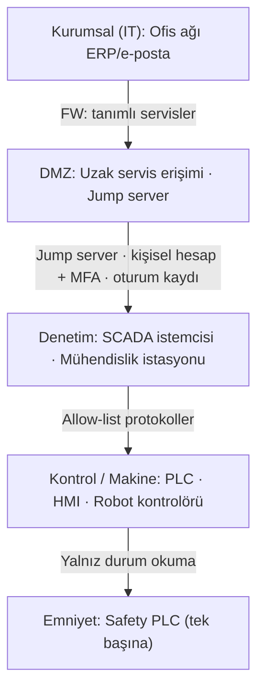

# Lab 2.1 · Lab 2: IEC 62443 Mini Workshop — Şişeleme Hattı
**Çıktı:** Zone / Conduit Diagram · **Evidence Pack:** EP 05 — Zone & Conduit

## Görev A
1. **Bölgeler:** Kurumsal (IT) · DMZ · Denetim (supervisory) · Kontrol/Makine · Emniyet.
2. **Safety PLC:** Ayrı ve en yüksek bölgede; insan hayatını koruyan tek fonksiyon orada çalışır. Kontrol bölgesine saldırgan girse bile emniyet bölgesine ancak ayrı bir kapıdan geçebilmelidir.
3. **Conduit'ler ve kontroller:**
   - Kurumsal ↔ DMZ: güvenlik duvarı, yalnız tanımlı servisler; ofisten makineye doğrudan yol yok.
   - DMZ ↔ Denetim: yalnız jump server, kişisel hesap + MFA, oturum kaydı.
   - Denetim ↔ Kontrol: izinli protokol listesi (allow-list); program yükleme yalnız mühendislik istasyonundan.
   - Kontrol ↔ Emniyet: varsayılan yalnız durum okuma; Safety PLC'ye yazma/program yükleme yalnız yerinde, yetkili kişiyle ve değişiklik yönetimiyle.

## Görev B — Uzak erişim kararı
| Karar | Seçim | Neden |
|---|---|---|
| Aracı | Jump server | Makine internete doğrudan görünmez; tek, izlenen giriş noktası |
| Tünel | VPN | Trafik şifreli; açık port tarayan otomatik saldırılar kapıyı göremez |
| Kimlik | MFA | Çalınan parola tek başına yetmez |
| Hesap | Kişisel | Kimin ne yaptığı bilinir; ayrılanın hesabı tek tek kapatılır |
| Kayıt | Tam oturum kaydı | Olayda kanıt, denetimde "kayıt" seviyesinde ispat |
| Zamanlama | Varsayılan kapalı | Yalnız talep + onayla, süre sınırlı açılır; kapalı kapı saldırı yüzeyi değildir |
