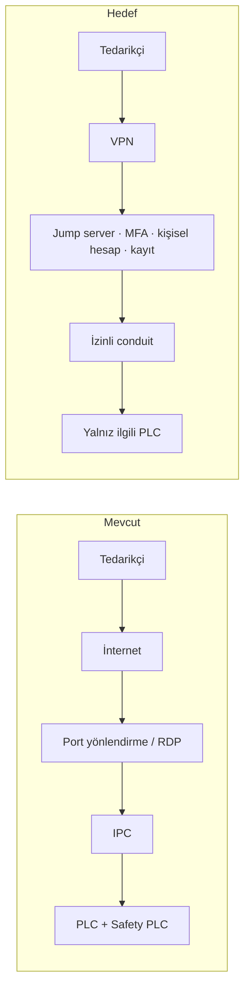

# Lab 2.1 · Lab 4: Secure Remote Access — Şişeleme Hattı
**Çıktı:** Secure Architecture · **Evidence Pack:** EP 02 + EP 06

## Görev A — Mevcut → Hedef
- **Mevcut:** Tedarikçi → internet → (port yönlendirme / uzak masaüstü aracı) → IPC → PLC ağı. Paylaşılan hesap, yalnız parola, kayıt yok, 7/24 açık; IPC'den Safety PLC'ye yol var.
- **Hedef:** Tedarikçi → VPN → DMZ'deki jump server (MFA + kişisel hesap) → izinli conduit → yalnız ilgili PLC. Erişim talep üzerine, süre sınırlı açılır; tüm oturum kaydedilir. Safety PLC'ye uzaktan yazma yolu yok.

## Görev B — Functional safety köprüsü
1. **Saldırgan içeri girerse emniyet etkilenir mi?** Mimariye bağlı. Emniyet fonksiyonu IPC'den bağımsız Safety PLC'deyse ve uzak yoldan o PLC'ye yazılamıyorsa saldırgan üretimi bozabilir ama E-stop/ışık perdesi çalışmaya devam eder. Sarı çizgi açıksa (IPC Safety PLC'yi programlayabiliyorsa) **evet, etkilenir**.
2. **Gereksinim (çözüm değil):**
   - Emniyet fonksiyonu, normal kontrol sistemi ve uzak erişim yolu tamamen ele geçirilse bile gerekli PLr ile çalışmaya devam etmelidir.
   - Emniyet konfigürasyonu yalnız yetkili, kimliği doğrulanmış ve kayıt altındaki bir işlemle değiştirilebilmeli; uzaktan değiştirilememelidir.
   - Konfigürasyondaki her değişiklik tespit edilebilmeli (checksum/imza) ve yeniden doğrulama gerektirmelidir.

> En güçlü tek yatırım: emniyet fonksiyonunu IPC'den bağımsız bir Safety PLC'ye almak.
