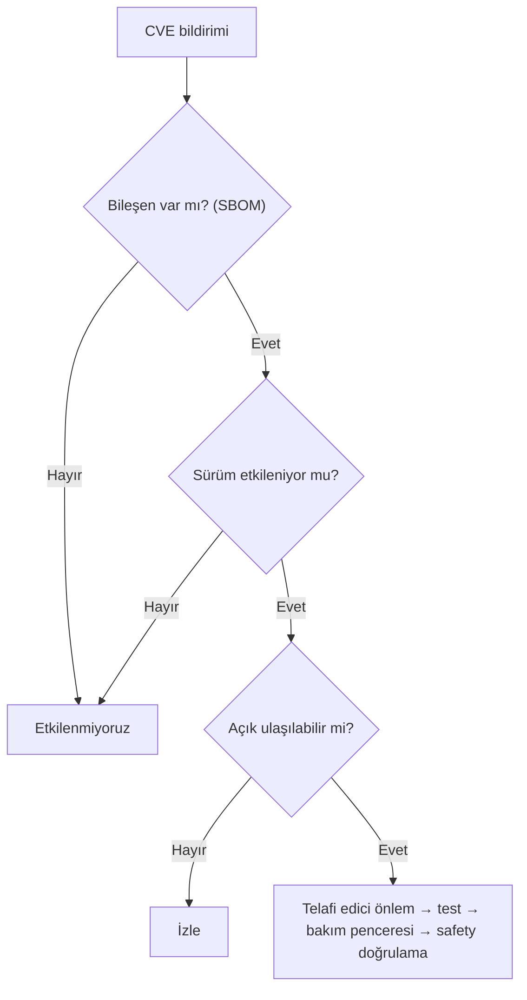

# Lab 2.1 · Lab 5: SBOM / CVE / Patch — Şişeleme Hattı
**Çıktı:** Vulnerability Decision · **Evidence Pack:** EP 09 · 10 · 11

Verilen kayıt: **Component X** (PLC firmware kütüphanesi) · sürüm 2.4 · CVE-XXXX-XXXX · Critical (CVSS 9.8) · yama mevcut.

1. **Etkiliyor mu?** (a) Var: SBOM'a göre Component X hangi PLC'lerde? (b) Sürüm: bizdeki 2.4, CVE aralığında mı? (c) Ulaşılabilir: açık servis bizde etkin mi, kim erişiyor? Bu hatta PLC kontrol bölgesinde; dışarıdan yalnız uzak servis yolu ve mühendislik istasyonu ulaşıyor. Üç şart da sağlanıyorsa "etkileniyoruz" denir.
2. **Üretimi durdurur muyum?** Hayır, hemen değil. CVSS 9.8 tek başına durdurma sebebi değil; önce ulaşılabilirliği keser, telafi edici önlem alırım. Aktif istismar belirtisi varsa veya ulaşılabilirlik kesilemiyorsa kontrollü durdurmayı değerlendiririm.
3. **Doğrudan mı, test mi?** Önce test. Yedek PLC / test tezgahında (veya üreticinin doğruladığı ortamda), tam yedek alınır, planlı bakım penceresinde ve geri dönüş planıyla uygulanır.
4. **Safety validation etkilenir mi?** Component X Safety PLC'de de varsa veya yama emniyet programını, zamanlamayı ya da checksum'ı değiştiriyorsa evet. Üretici sürüm notlarına ve yama öncesi/sonrası safety checksum'a bakılır; değişmişse emniyet fonksiyonları yeniden test edilip doğrulama kaydı güncellenir.
5. **Yama mümkün değilse:** Etkilenen servisi kapat, ilgili portu conduit'te engelle, uzak erişimi varsayılan kapalı tut, PLC erişimini allow-list ile sınırla, ağ izleme (IDS) ile istismar denemesini algıla, kararı tarih + sorumlu ile kayıt altına al.
