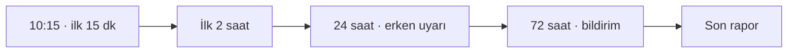

# Lab 2.1 · Lab 6: CRA Incident Simulation — Şişeleme Hattı
**Çıktı:** Incident Workflow · **Evidence Pack:** EP 13 — Incident Response

**Senaryo:** 10:15 — servis hesabında yetkisiz erişim tespit edildi, PLC konfigürasyonu değişmiş olabilir, makine hâlâ çalışıyor. Vardiya sorumlusu sizsiniz.

> **En sık hata:** "Resetleyip devam edelim" — o düğme kanıtı sonsuza dek siler. Önce emniyet, hemen sonra kanıt.

1. **10:15 — ilk 15 dk.** Aranacaklar: bakım/OT sorumlusu, IT güvenlik, İSG/emniyet sorumlusu, yönetim (olay sahibi). İlk üç eylem: (1) PLC konfigürasyonu değişmiş olabileceği için hattı kontrollü durdurup güvenli duruma almak, reset/yeniden yükleme yapmamak; (2) uzak erişim yolunu fiziksel ya da güvenlik duvarından kesmek; (3) saat damgalı olay günlüğü başlatmak.
2. **İlk 2 saat.** *Emniyet:* Safety PLC checksum'ı referans değerle karşılaştırılır, E-stop ve ışık perdesi fonksiyon testi yapılır. *Kanıt:* PLC/Safety PLC'deki program değiştirilmeden okunup hash'lenir; güvenlik duvarı, VPN, uzak erişim ve HMI logları kopyalanır. *Hesap:* ihlal edilen servis hesabı devre dışı bırakılır, aynı parolayı paylaşan tüm hesaplar değiştirilir.
3. **24 saat — erken uyarı:** Olayın tespit zamanı, etkilenen ürün/makine ve sürüm, kasti (kötü niyetli) olma şüphesi, başka müşteri veya ülkelere etki ihtimali.
4. **72 saat — bildirim:** İlk kök neden değerlendirmesi, etki ve ciddiyet, alınan/önerilen önlemler. OT + IT log ve konfigürasyon analizini, emniyet sorumlusu fonksiyon doğrulamasını, tedarikçi kendi tarafındaki erişim kayıtlarını yapar; yönetim (A) bildirimi onaylar.
5. **Son rapor:** Güvenlik duvarı/VPN/jump server oturum logları, kimlik doğrulama logları, PLC proje ve değişiklik geçmişi, Safety PLC checksum kayıtları, HMI denetim izi, olay günlüğü ve test kayıtları.

> **Not:** CRA'da 14 günlük son rapor, aktif istismar edilen açıklar için düzeltme yayımlandıktan sonraki süredir; ciddi olaylarda son rapor süresi bir aydır. "24s / 72s / 14g" bir sadeleştirmedir. CRA bildirim yükümlülüğü ürün üreticisine aittir; yalnız işleten fabrika üreticiye haber verir (NIS2 gibi ayrı yükümlülükleri olabilir).
