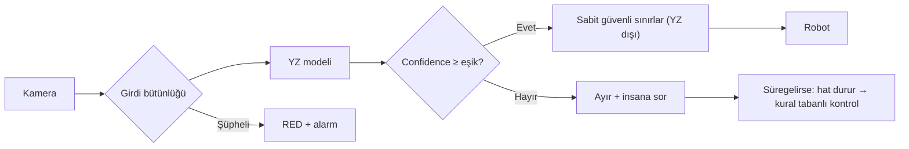

# Lab 2.1 · Lab 7: AI Safety Challenge — Şişeleme Hattı
**Çıktı:** AI Fail-Safe Decision · **Evidence Pack:** EP 03 + EP 15

**Prediction ≠ Safety.** YZ karar üretir; güvenliği garanti eden mimari YZ'nin dışında tanımlanır (fail-safe, human override, monitoring, confidence threshold, fallback).

**Zincir:** Kamera → YZ modeli → OK/RED → parametre → robot.

1. **Yanlış sınıflandırma (kusurluya OK):** YZ'den bağımsız ikinci kontrol (seviye sensörü, kapak torku, tartı) ve periyodik insan numune kontrolü. YZ'nin robota verdiği parametreler, YZ dışında tanımlı sabit güvenli sınırları aşamaz.
2. **Girdi manipülasyonu:** Donmuş/tekrarlanan kare, zaman damgası ve kare sayacı kontrolü, bulanıklık/parlaklık izleme, düzenli referans hedef görüntüsü. Şüpheli girdide parça RED'e düşer, alarm verilir; sürerse hat durur.
3. **Confidence düşük:** Eşik, doğrulama verisinde kabul edilebilir yanlış-OK oranını sağlayacak şekilde belirlenir. Altında parça ayrılır ve insana sorulur; arka arkaya düşük confidence gelirse hat durur ve kural tabanlı kontrole (fallback) geçilir.

| Başarısızlık | Tanımlanan güvenli davranış (kavram) |
|---|---|
| Model yanlış sınıflandırdı | Bağımsız ikinci kontrol + insan numune onayı; parametreye sabit sınır (monitoring, human override, fail-safe) |
| Girdi manipüle edildi | Girdi bütünlüğü izleme; şüphede RED ve alarm (monitoring, fail-safe) |
| Confidence düştü | Eşik altında ayır + insana sor; sürerse dur ve kural tabanlı kontrol (confidence threshold, human override, fallback) |
