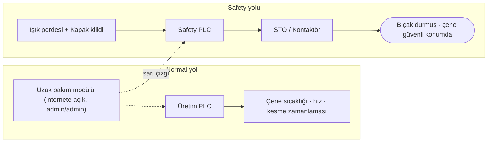

# Lab 2.2 · Lab 1: Safety Architecture — PaketPro 3000
**Çıktı:** Safety Function Map · **Evidence Pack:** EP 03

> **Makine:** Sıcak yapıştırma çenesi + film kesme bıçağı; koruma: ışık perdesi + kapak kilidi → Safety PLC → STO. **En büyük sorun:** internete doğrudan açık uzak bakım modülü ve `admin/admin` hesabı.

| # | Soru | Cevap |
|---|------|-------|
| 1 | Tehlike | Kesme bıçağında parmak/el kesilmesi veya kopması, sıcak çenede ezilme ve yanık, film besleme merdanelerinde sıkışma. Operatör en çok film sıkışmasını giderirken maruz kalır. |
| 2 | Safety function | (a) Işık perdesi kesildiğinde çene ve bıçak hareketi STO ile durur. (b) Kapak kilidi, tehlikeli hareket tamamen durmadan kapağın açılmasını engeller ve kapak açıkken çalışmayı önler. |
| 3 | Safety-related control system | Işık perdesi + kapak kilidi (giriş) → Safety PLC (mantık) → STO/kontaktör (çıkış). Uzak bakım modülü, üretim PLC'si ve HMI bunun dışındadır. |
| 4 | Normal PLC vs Safety PLC | Üretim PLC'si çene sıcaklığını, hızı ve kesme zamanlamasını yönetir; hatası sessiz olabilir. Safety PLC yedekli ve kendini test eder, hatada güvenli duruma geçer, programı checksum ile korunur. |
| 5 | PLr / SIL | Bıçakta geri dönüşsüz yaralanma (amputasyon), sık maruziyet (her sıkışmada) ve kaçınma zorluğu yüksek PLr gerektirir; tipik **PL d, hatta e**. Değer ışık perdesinin tepki süresine ve güvenlik mesafesine bağlı olduğundan parametreler kritiktir. |
| 6 | Safe state | Çene ve bıçak tahrikinde enerji kesilmiş (STO), bıçak durmuş, çene açık/güvenli konumda, kapak kilidi ancak hareket bitince açılır; yeniden başlama yalnız reset ile. *Not:* çene STO sonrası da sıcak kalır; yanık riski ayrıca ele alınmalı. |
| 7 | Dijital bağımlılıklar | Safety PLC programı ve parametreleri (ışık perdesi çözünürlük/blanking/muting, tepki süresi, kapak kilidi gecikmesi), firmware, emniyet ağı, programlama aracı ve parolası. |
| 8 | Siber müdahale noktası | İnternete açık uzak bakım modülü (admin/admin) → PLC ağı → Safety PLC konfigürasyonu (sarı çizgi). **Yan kapılar:** kilitsiz USB, kartondaki parolayla Wi-Fi, port 80 HMI. |
