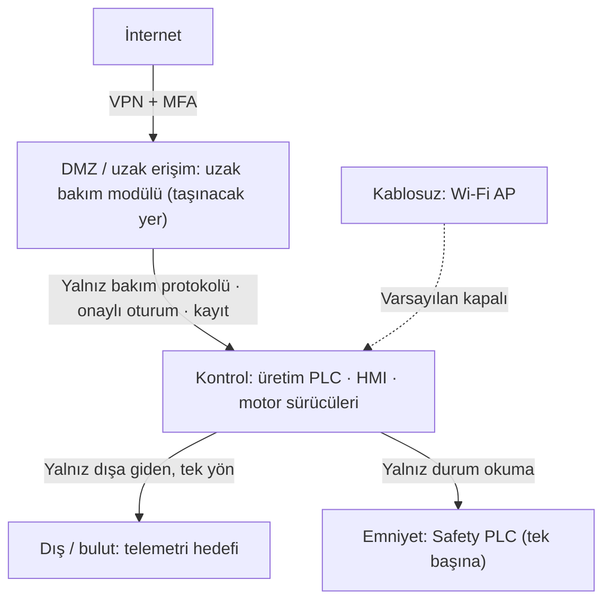

# Lab 2.2 · Lab 2: IEC 62443 Mini Workshop — PaketPro 3000
**Çıktı:** Zone / Conduit Diagram · **Evidence Pack:** EP 05

## Görev A
1. **Bölgeler:** Dış/bulut · DMZ/uzak erişim · Kontrol · Emniyet · Kablosuz. **Bölge olmayan bulgular:** 2 kilitsiz USB (fiziksel erişim politikası + port kilidi) ve admin/admin hesabı (kaldırılır, kişisel hesaplarla değiştirilir).
2. **Uzak bakım modülü bugün fiilen kontrol bölgesinde** ve oraya internetten doğrudan kapı açıyor. Orada kalamaz: en riskli conduit, en kritik bölgeye aracısız bağlanmış olur. DMZ'ye taşınır, önüne güvenlik duvarı konur, varsayılan kapalı tutulur.
3. **Conduit'ler:**
   - İnternet ↔ DMZ: VPN + MFA; gelen doğrudan bağlantı yok.
   - DMZ ↔ Kontrol: yalnız bakım için gereken protokol, yalnız onaylı oturumda, kayıt altında.
   - Kontrol → Bulut: yalnız dışa giden telemetri, tek yön; geri komut kanalı yok.
   - Kontrol ↔ Emniyet: yalnız durum okuma; konfigürasyon yazımı yerinde ve yetkiyle.
   - Wi-Fi ↔ Kontrol: varsayılan kapalı; açılacaksa güçlü, kişisel kimlik doğrulamalı.
   - HMI'nın port 80 web arayüzü kapatılır veya şifreli ve parolalı hale getirilir.

## Görev B — Uzak erişim kararı
| Karar | Seçim | Neden (PaketPro'ya özel) |
|---|---|---|
| Aracı | Jump server | Modülün bugünkü doğrudan internet bağlantısı kapatılır |
| Tünel | VPN | Açık kapı tarayan fırsatçı saldırganlara görünmez |
| Kimlik | MFA | admin/admin gibi zayıf parolanın riski ortadan kalkar |
| Hesap | Kişisel | Tek ortak servis hesabı yerine her teknisyene ayrı hesap |
| Kayıt | Tam oturum kaydı | Gece 03:00 girişi sonradan ispatlanabilir (Lab 6) |
| Zamanlama | Varsayılan kapalı | Modül yalnız talep + onayla, süre sınırlı açılır |
