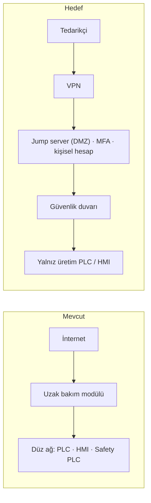

# Lab 2.2 · Lab 4: Secure Remote Access — PaketPro 3000
**Çıktı:** Secure Architecture · **Evidence Pack:** EP 02 + EP 06

## Görev A — Mevcut → Hedef
- **Mevcut:** İnternet → uzak bakım modülü (doğrudan açık) → düz makine ağı (PLC, HMI, Safety PLC). Tek ortak `admin/admin` hesabı, MFA yok, kayıt yok, 7/24 açık.
- **Hedef:** Tedarikçi → VPN → DMZ'de jump server (MFA, kişisel hesap) → güvenlik duvarı → yalnız üretim PLC / HMI. Modül varsayılan kapalı, talep ve onayla süre sınırlı açılır; oturumlar kaydedilir. Safety PLC'ye uzaktan yazma yolu yok.

## Görev B
1. **Etkilenir mi?** Bugünkü düz ağda **evet**: modül Safety PLC'ye ulaşabildiği için ışık perdesi parametreleri değiştirilebilir. Hedef mimaride **hayır**: saldırgan üretimi aksatabilir ama emniyet zinciri ayrı ve uzaktan yazılamaz olduğu için ışık perdesi çalışmaya devam eder.
2. **Gereksinim (çözüm değil):**
   - Işık perdesi + kapak kilidi → Safety PLC → STO zinciri, uzak bakım yolu ve üretim kontrol sistemi tamamen ele geçirilse bile gerekli PLr ile çalışmalıdır.
   - Emniyet parametreleri uzak bakım yolundan okunabilir ama değiştirilemez olmalıdır; değişiklik yalnız yerinde, yetkili ve kayıt altında yapılabilmelidir.
   - Emniyet konfigürasyonundaki her değişiklik tespit edilebilir olmalı ve makineyi yeniden doğrulama yapılana dek çalıştırmamalıdır.
