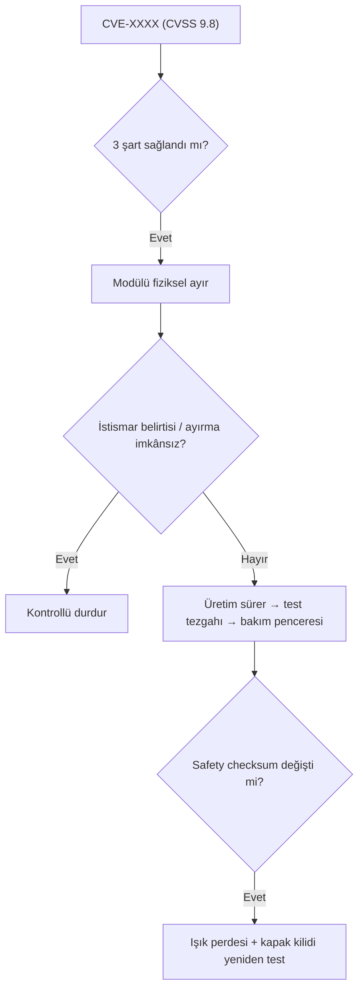

# Lab 2.2 · Lab 5: SBOM / CVE / Patch — PaketPro 3000
**Çıktı:** Vulnerability Decision · **Evidence Pack:** EP 09 · 10 · 11

Kayıt: Component X (PLC firmware) · sürüm 2.4 · Critical (CVSS 9.8) · yama mevcut. **Genel Sürüm'den çok daha acil** — modül internete açık ve ağ düz.

1. **Etkiliyor mu?** *Var:* PaketPro SBOM'unda Component X PLC firmware'inde var. *Sürüm:* 2.4, bildirimdeki etkilenen aralıkla karşılaştırılır. *Ulaşılabilir:* modül internete açık ve ağ düz olduğu için PLC dışarıdan ulaşılabilir. Sürüm etkileniyorsa üç şart da sağlanır.
2. **Üretimi durdurur muyum?** Önce ulaşılabilirliği keserim: uzak bakım modülünün internet bağlantısını hemen **fiziksel olarak** ayırırım. Bu yapılabiliyorsa üretim sürebilir. Kesilemiyorsa veya istismar belirtisi varsa (beklenmeyen giriş, konfigürasyon farkı) makineyi kontrollü durdururum.
3. **Doğrudan mı, test mi?** Test. Üreticiden (PaketPro) yamanın bu makine için doğrulandığı teyidi alınır; yedek PLC veya test tezgahında denenir; tam yedek + geri dönüş planıyla bakım penceresinde uygulanır.
4. **Safety validation etkilenir mi?** Yama Safety PLC firmware'ini, emniyet programını veya tepki sürelerini değiştiriyorsa evet. Kontrol: sürüm notları, yama öncesi/sonrası safety checksum. Fark varsa ışık perdesi (test çubuğu, tepki süresi, güvenlik mesafesi) ve kapak kilidi yeniden test edilip kayıt güncellenir.
5. **Yama mümkün değilse:** Modülü internetten kalıcı ayırmak ve yalnız VPN + jump server ile açmak, ilgili servisi/portu kapatmak, admin/admin'i kaldırmak, PLC erişimini allow-list ile sınırlamak, ağ izleme ve kararı tarih + sorumluyla kayıt altına almak.

