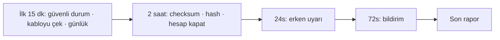

# Lab 2.2 · Lab 6: CRA Incident Simulation — PaketPro 3000
**Çıktı:** Incident Workflow · **Evidence Pack:** EP 13

> **Föy hatası notu:** Orijinal föyde Soru 2 "Egzoz güvende mi?" diyor; bu Kbotic boya hattından kalmıştır. PaketPro'da doğrulanacak emniyet fonksiyonu **ışık perdesi + kapak kilididir**.

**Senaryo:** Gece 03:00'te uzak bakım modülüne yetkisiz giriş; PLC konfigürasyonu değişmiş olabilir.

1. **10:15 — ilk 15 dk.** Aranacaklar: bakım/OT sorumlusu, emniyet (İSG) sorumlusu, IT güvenlik, yönetim, PaketPro servisi. İlk üç eylem: (1) makineyi hemen güvenli duruma almak — ışık perdesi parametreleri doğrulanmadığı için kimse koruma alanına girmez, ama **reset/yeniden yükleme yapılmaz**; (2) uzak bakım modülünün internet kablosunu çekmek; (3) saat damgalı olay günlüğü başlatmak.
2. **İlk 2 saat.** *Doğrulama:* Safety PLC checksum'ı referans değerle karşılaştırılır; ışık perdesi test çubuğuyla, tepki süresi ve muting/blanking ayarları kontrol edilir; kapak kilidi denenir. *Kanıt:* PLC ve Safety PLC'deki program değiştirilmeden okunup hash'lenir; modülün bağlantı logları (03:00 girişi, IP/konum) ve HMI logları kopyalanır. *Hesap:* admin/admin servis hesabı kapatılır.
3. **24 saat — erken uyarı:** 03:00'teki yetkisiz giriş ve tespit zamanı, etkilenen ürün (PaketPro 3000) ve firmware sürümü, kötü niyet şüphesi, aynı modülü kullanan başka müşteri/ülkelere etki ihtimali.
4. **72 saat — bildirim:** Kök neden ilk değerlendirmesi (internete açık modül + varsayılan parola), konfigürasyonda ne değişti, emniyete etkisi ve alınan önlemler. OT + IT log analizini, emniyet sorumlusu yeniden doğrulamayı, PaketPro modülün üretici tarafı analizini yapar; yönetim (A) onaylar.
5. **Son rapor:** Modül ve güvenlik duvarı bağlantı logları, kimlik doğrulama kayıtları, PLC ve Safety PLC proje dosyaları ile checksum geçmişi, HMI denetim izi, fonksiyon test kayıtları ve olay günlüğü.

> **CRA'da kim bildirir?** Yükümlülük dijital unsurlu ürünün **üreticisine** (PaketPro) aittir. Makineyi yalnız işleten fabrika üreticiye haber verir; NIS2 gibi başka yükümlülükleri olabilir. "14 gün" bir sadeleştirmedir: aktif istismar edilen açıklarda düzeltme sonrası süredir; ciddi olaylarda son rapor süresi bir aydır.
