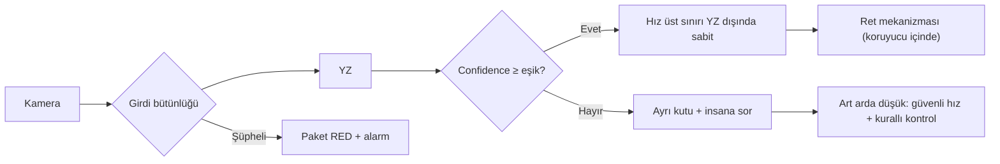

# Lab 2.2 · Lab 7: AI Safety Challenge — PaketPro 3000
**Çıktı:** AI Fail-Safe Decision · **Evidence Pack:** EP 03 + EP 15

**Proje aşaması:** Kamera → YZ modeli → OK/RED → ret mekanizması → hat hızı. Bu aşamada kararlar **tasarım gereksinimi** olarak yazılır.

1. **Kusurlu pakete OK:** Bağımsız ikinci kontrol (dolum ağırlığı için tartı, kaynak/mühür kontrolü) ve vardiyada insan numune kontrolü. YZ hat hızını etkiliyorsa hız üst sınırı YZ dışında sabit tutulur; ret mekanizması da koruyucu içinde kalır.
2. **Kamera girdisi bozuk/sahte:** Donmuş kare, zaman damgası/kare sayacı, bulanıklık ve ışık seviyesi izlenir; düzenli referans görüntü ile karşılaştırılır. Şüphede paket reddedilir, alarm verilir, sürerse hat yavaşlatılır/durdurulur.
3. **Confidence düşük:** Eşik, pilot verisinde kabul edilebilir yanlış-OK oranına göre belirlenir. Altında paket ayrı kutuya alınıp insana sorulur; arka arkaya düşük sonuçta hat güvenli hıza düşer ve klasik kurallı kontrole geçilir.

| Başarısızlık | Tanımlanan güvenli davranış (kavram) |
|---|---|
| Model yanlış sınıflandırdı | Bağımsız ikinci kontrol + insan numunesi; hat hızına YZ dışı sabit sınır (monitoring, human override, fail-safe) |
| Girdi manipüle edildi | Girdi bütünlüğü izleme; şüphede reddet ve alarm (monitoring, fail-safe) |
| Confidence düştü | Eşik altında ayır + insana sor; sürerse güvenli hız ve kurallı kontrol (confidence threshold, human override, fallback) |

> **Prediction ≠ Safety:** Bıçak/çene korumasını sağlayan ışık perdesi + kapak kilidi + Safety PLC zinciri YZ'nin tamamen dışındadır.
